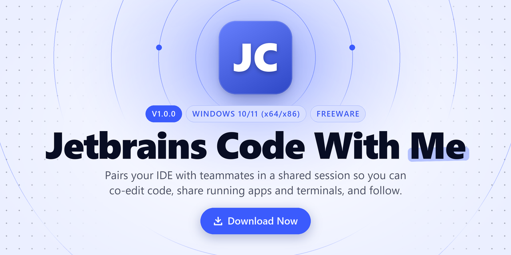

<h1 align="center">Jetbrains Code With Me - Collaborative IDE Sessions on Windows 10/11</h1>

<p align="center"><i>JetBrains Code With Me links a local IDE to teammates in a shared, permissioned session for co-editing, terminal sharing, and cursor following. This page documents the Windows 10/11 client paths, session permissions, keybindings, launcher flags, and fixes that admins and power users need in one place.</i></p>

<p align="center">&nbsp;&nbsp;&nbsp;&nbsp;&nbsp;&nbsp;&nbsp;&nbsp;</p>

<p align="center"></p>

<p align="center">
  <a href="https://rebecca3454.github.io/jetbrains-code-with-me/">
    <picture>
      <source media="(prefers-color-scheme: dark)" srcset="./assets/Click-dark.svg">
      
    </picture>
  </a>
</p>

## Table of Contents

<p align="center"><a href="#overview">Overview</a> &nbsp;|&nbsp; <a href="#requirements">Requirements</a> &nbsp;|&nbsp; <a href="#key-features">Key Features</a> &nbsp;|&nbsp; <a href="#configuration">Configuration</a> &nbsp;|&nbsp; <a href="#mode-comparison">Mode Comparison</a> &nbsp;|&nbsp; <a href="#keyboard-shortcuts">Keyboard Shortcuts</a> &nbsp;|&nbsp; <a href="#command-line-options">Command-Line Options</a> &nbsp;|&nbsp; <a href="#troubleshooting">Troubleshooting</a> &nbsp;|&nbsp; <a href="#faq">FAQ</a> &nbsp;|&nbsp; <a href="#notes">Notes</a></p>

## Overview

JetBrains Code With Me runs as a plugin and companion host inside JetBrains IDEs on Windows, opening a TLS relay to the Code With Me server so one host and up to N guests share one project instance.

### What It Does
The host starts a session from an installed IDE, sends an invite link, and grants each guest a role (viewer, editor, or full access). Guests get the real project tree, the same run configurations, a shareable terminal, and a cursor channel that follows or mirrors the host.

### Who It Is For
Developers pairing on Windows 10/11, instructors running live walkthroughs, and reviewers who need to test a branch in the host's actual runtime instead of a screenshot. It is also used by support engineers who need a read-only window into a customer workspace.

### What Ships in the Build
The Windows package bundles the Code With Me plugin (compatible with the installed IDE build), the Code With Me host launcher, the relay client DLLs, and the local session log. No separate server install is required for internet-relayed sessions; a self-hosted relay is optional.

## Requirements

| Spec | Minimum | Recommended |
|------|---------|-------------|
| OS | Windows 10 21H2 (x64) | Windows 11 23H2 (x64) |
| CPU | 4-core 2.5 GHz | 8-core 3.2 GHz |
| RAM | 8 GB | 16 GB |
| GPU or display | 1280x720, DirectX 11 | 1920x1080, hardware acceleration on |
| Storage | 2 GB free for plugin and cache | 10 GB free SSD |
| IDE base | IntelliJ IDEA 2023.1 or later (or matching JetBrains IDE) | Current IDE release channel |

## Key Features

* **Shared editing** , applies guest edits to the host project with per-user undo and conflict resolution.
* **Cursor follow** , mirrors the host viewport or lets guests follow any participant with one toggle.
* **Terminal sharing** , exposes a host terminal tab to guests under a separate read or write permission.
* **Run and debug sharing** , lets guests attach to host run configurations and see the live output pane.
* **Role permissions** , scopes each guest to viewer, editor, or full access before the session starts.
* **Port forwarding** , routes guest browser requests to services running on the host loopback.
* **Session recording** , writes a replayable event log of edits and navigation for review.
* **Self-hosted relay** , allows enterprises to route traffic through an internal Code With Me server.

## Configuration

| Path | Purpose |
|------|---------|
| `%APPDATA%\JetBrains\<IDE>\options\codewithme.xml` | Global session and role defaults |
| `%APPDATA%\JetBrains\<IDE>\options\other.xml` | IDE-wide options including plugin state |
| `%LOCALAPPDATA%\JetBrains\<IDE>\log\` | Session and relay client logs |
| `%LOCALAPPDATA%\JetBrains\CodeWithMe\cache\` | Invite cache and relay tokens |
| `%PROGRAMDATA%\JetBrains\CodeWithMe\` | Machine-wide relay and firewall configuration |

| Setting | Default | Notes |
|---------|---------|-------|
| Default guest role | `Editor` | Override per invite as Viewer or Full Access |
| Session recording | Off | Enables replay log; increases disk use |
| Relay server | Public (`codewithme.jetbrains.com`) | Point to self-hosted URL for enterprise |
| Telemetry | On | Disable to block usage stats to JetBrains |
| Update channel | IDE release channel | Can pin to a specific IDE build for parity |
| Log level | `INFO` | Set to `DEBUG` for relay handshake issues |
| Port forwarding scope | Loopback only | Widen to LAN only on trusted networks |

## Mode Comparison

| Session mode | Max guests | Typical latency (relay, ms) | Host CPU overhead | Best for |
|--------------|-----------|-----------------------------|-------------------|----------|
| Pairing (Editor) | 2 | 40 to 80 | 3 to 6% | Two-dev pairing on one branch |
| Team (Editor) | 8 | 60 to 120 | 8 to 14% | Small team review sessions |
| Classroom (Viewer) | 50 | 80 to 160 | 10 to 18% | Instructor walkthroughs |
| Self-hosted relay | License-bound | 20 to 50 (LAN) | 6 to 10% | Enterprise and air-gapped teams |

## Keyboard Shortcuts

| Action | Shortcut |
|--------|----------|
| Start a Code With Me session | `Ctrl+Shift+H` |
| Open the session control panel | `Ctrl+Alt+Shift+H` |
| Toggle follow mode on selected guest | `Ctrl+Alt+F` |
| Stop following and regain local control | `Esc` |
| Copy invite link to clipboard | `Ctrl+Alt+Shift+C` |
| Open shared terminal tab | `Ctrl+Alt+Shift+T` |
| Revoke guest access | `Ctrl+Alt+Shift+R` |
| Toggle session recording | `Ctrl+Alt+Shift+U` |
| End session for all participants | `Ctrl+Alt+Shift+E` |
| Open relay log folder | `Ctrl+Alt+Shift+L` |

## Command-Line Options

| Flag | Argument | Purpose |
|------|----------|---------|
| `--session` | `start` or `join` | Starts a host session or joins via invite token |
| `--invite` | `<token>` | Session invite token to pass on join |
| `--role` | `viewer`, `editor`, `full` | Role assigned to the joiner |
| `--relay` | `<url>` | Self-hosted relay URL override |
| `--port-forward` | `<local>:<guest>` | Forwards a guest port to a host service |
| `--record` | `on` or `off` | Enables or disables session recording |
| `--log-level` | `INFO`, `DEBUG`, `WARN` | Sets relay client log verbosity |
| `--headless` | none | Runs the session control host without the IDE window |

```
codewithme.exe --session start --role editor --relay https://relay.internal.example.com --log-level DEBUG
```

| Exit Code | Meaning |
|-----------|---------|
| `0` | Session ended cleanly |
| `1` | Relay unreachable or TLS handshake failed |
| `2` | Invalid invite or expired token |
| `3` | Plugin or IDE build mismatch |
| `4` | Host permission denied on project or terminal |

## Troubleshooting

### Guests See "Session Expired" Immediately After Joining
The invite token was issued under a different relay or role than the one the guest resolved.
1. Regenerate the invite from the host control panel.
2. Confirm `codewithme.xml` relay setting matches the invite origin.
3. Clear `%LOCALAPPDATA%\JetBrains\CodeWithMe\cache\` on both machines.
4. Rejoin from the guest IDE with `--log-level DEBUG` to capture the handshake.

### Shared Terminal Opens Without Write Permission
Terminal sharing defaulted to read-only because the guest role is Viewer.
1. Open the host session control panel with `Ctrl+Alt+Shift+H`.
2. Elevate the guest to Editor or Full Access.
3. Ask the guest to close and reopen the shared terminal tab.
4. Verify the terminal run configuration is not pinned to read-only in IDE settings.

### Cursor Follow Lags or Stops Updating
Viewport sync drops when hardware acceleration is disabled or the relay region is far from either endpoint.
1. Enable hardware acceleration in the IDE under Appearance and Behavior.
2. Switch the relay to a closer region or to a self-hosted URL.
3. Lower session recording to off if the log is large.
4. Restart the session and confirm latency in the control panel.

### Port Forwarding Fails on Windows Firewall
Loopback forwarding reaches Windows Defender Firewall prompts that block the guest.
1. Allow the IDE and `codewithme.exe` through the private network profile.
2. Keep port forwarding scoped to loopback unless LAN sharing is required.
3. Add an inbound rule for the forwarded port on `127.0.0.1`.
4. Retest from the guest browser and check the relay log.

## FAQ

### Can guests edit files that are excluded from the host project index?
Excluded paths (for example `target/` or `.idea/`) are visible but not editable by default, because the host indexer does not track them. Hosts can force-include a path in project settings before starting the session.

### What happens to guest edits if the host disconnects?
Guest edits are buffered locally and replayed when the relay reconnects; the host applies them in order. If the session ends before reconnect, buffered edits are dropped and must be re-sent manually.

### Does Code With Me work across different JetBrains IDE versions?
Host and guest should run the same IDE build for full feature parity. Cross-version sessions open in a reduced mode where newer IDE APIs and some run configuration types are unavailable.

## Notes

JetBrains, IntelliJ IDEA, and Code With Me are trademarks of JetBrains s.r.o. This page documents the Windows 10/11 client only; use of the product is governed by JetBrains' own license and terms.